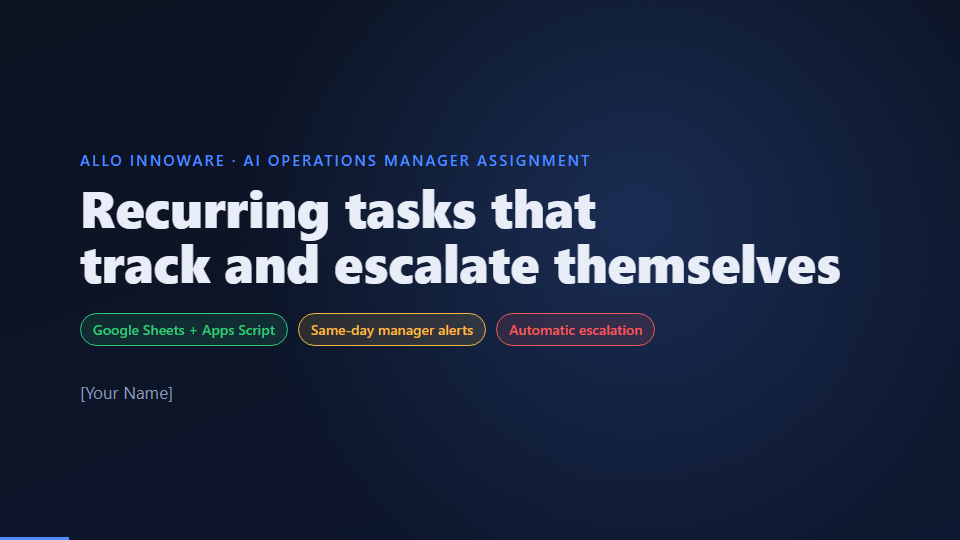

# Recurring Task Tracker (Google Sheets + Apps Script)

A recurring-task tracker for a small operations team, built on Google Sheets and Apps Script with no servers or paid services. It creates daily and 7/15/30-day tasks on schedule, lets each employee complete a task from one place, alerts the manager the same day a task is missed, records the manager's response, and escalates to leadership with a stated reason if the miss isn't handled in time.

## Demo video (7 min 44 s)

[](docs/demo.mp4)

Click the image to play the video, which is stored in this repo as [docs/demo.mp4](docs/demo.mp4). The walkthrough runs live on the sheet: recurring cycles, daily and ticket completion, the same-day manager alert, acknowledgement, both leadership escalation reasons, and no duplicates on repeated runs.

## Features

- **Recurring cycles on a fixed schedule.** Every occurrence is one row in a ledger, with an ID of task plus due date, so a cycle can never be created twice. Late completion never shifts the next due date.
- **One place to update.** Employees see only their own tab. A Ticket ID completes a portal task after a format and uniqueness check; the daily update is typed once and shared to WhatsApp from the sheet, with the text and time kept as proof.
- **SLA chain.** Due, then a 30-minute grace, then a same-day manager email. The manager has four working hours to choose an action (this is the acknowledgement), then leadership is emailed once with the reason: *manager did not acknowledge*, *acknowledged but unresolved*, or *escalated by manager*.
- **Idempotent engine.** A 15-minute trigger can run any number of times without duplicate cycles, completions or emails (deterministic IDs, a log key written before each send, and a script lock).
- **Everything is a setting.** Working hours, due times, grace period and SLA windows live in the `Config` sheet.
- **Test tools.** A simulated clock replays a week in minutes, and a built-in suite of 43 tests (42 automatic, 1 manual) runs inside the sheet. The same suite runs locally against a mock of Google Sheets.

## Repository layout

| Path | Contents |
|---|---|
| `apps-script/` | The Apps Script source (`.gs` files and `appsscript.json`) |
| `local-test/` | Node.js mock of Google Sheets and a runner for the test suite |
| `docs/SETUP.md` | How to install it in a sheet and run the demo |
| `docs/DESIGN_NOTE.md` | Design decisions: recurrence, completion, SLA reasoning, reliability, limits |

## Quick start

1. Create a Google Sheet, open **Extensions → Apps Script**, and copy in the files from `apps-script/` (or use [clasp](https://github.com/google/clasp)).
2. Reload the sheet and choose **Allo Ops → 1. Set up workbook**, then **2. Load demo data**.
3. Choose **Allo Ops → Run all tests** to check the install.

Full steps are in [docs/SETUP.md](docs/SETUP.md). Use a separate Google account with no personal data, and note that editors of a sheet can edit its bound script.

## Run the tests locally

```bash
node local-test/run.js
```

Expected result: `43 tests, 0 failed, 1 manual`.

## Known limits

Google often doesn't reveal which editor made an edit on personal Gmail, so each tab's owner is used as the identity. A personal Gmail account can send about 100 script emails a day. Whether a portal ticket really exists can't be checked without a portal API. See the design note for the full list and next steps.

## Licence

MIT. See [LICENSE](LICENSE).
